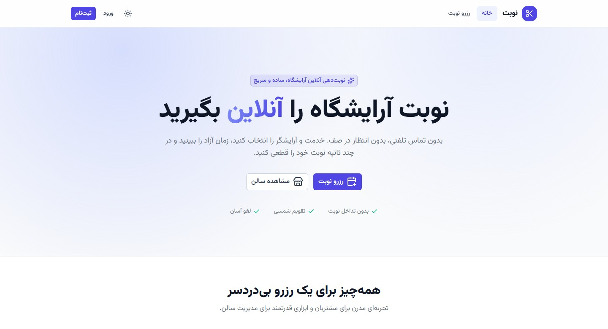

# نوبت

سامانه رزرو آنلاین نوبت آرایشگاه و سالن زیبایی، آماده برای استقرار در محیط عملیاتی.

معماری **Modular Monolith تمیز** با **ASP.NET Core 10** و **Nuxt 4**؛ کاملاً راست چین، با تقویم شمسی،
ساعت ۲۴ ساعته و حالت روشن و تاریک.




## ویژگیها

- **رزرو بدون تداخل.** زمانهای آزاد از ساعات کاری، مدت خدمت، استراحت و نوبتهای موجود محاسبه
  میشوند و قید انحصاری PostgreSQL در سطح database هم از تداخل جلوگیری میکند.
- **مدیریت درست زمان.** همه زمانها UTC ذخیره میشوند و منطقه زمانی کسب و کار (`Asia/Tehran`) از
  طریق `IBusinessTimeProvider` تزریق میشود.
- **تقویم شمسی دقیق.** تبدیل تاریخ جلالی به صورت حسابی پیاده سازی و با تستها تثبیت شده است.
- **خطاهای ساختاریافته.** خطاها به `ProblemDetails` مطابق RFC 7807 با کد ثابت و پیام فارسی تبدیل
  میشوند.
- **تست در سه سطح.** ۱۲۵ تست back-end، ۵۵ تست front-end و ۱۵ تست End-to-end. جزئیات در
  [docs/testing.md](docs/testing.md) و [docs/architecture.md](docs/architecture.md).

## فناوریها

| Layer | Technology |
| --- | --- |
| Front-end | Nuxt 4, Vue 3, TypeScript, Tailwind CSS 4, Nuxt UI, Pinia, Lucide icons |
| Back-end | ASP.NET Core 10, MediatR (CQRS-lite), FluentValidation |
| Database | EF Core 10, PostgreSQL 17, ASP.NET Core Identity |
| Auth | JWT access token (15 min) + rotating refresh token (7 days) |
| Testing | xUnit, Vitest, Playwright |
| DevOps | Docker, Docker Compose, GitHub Actions |

## ساختار پروژه

```
nobat/
├── backend/
│   ├── src/
│   │   ├── Nobat.Domain/          # Entities, enums, domain exceptions — no dependencies
│   │   ├── Nobat.Application/     # Use cases (MediatR), DTOs, validators, availability engine
│   │   ├── Nobat.Infrastructure/  # EF Core, migrations, Identity, JWT, time provider
│   │   └── Nobat.Api/             # Controllers, middleware, DI, Swagger
│   └── tests/
│       ├── Nobat.Domain.Tests/
│       ├── Nobat.Application.Tests/
│       └── Nobat.Api.Tests/       # integration tests against a real PostgreSQL
├── frontend/
│   ├── app/                       # pages, components, composables, stores, layouts
│   ├── tests/unit/                # Vitest
│   └── tests/e2e/                 # Playwright
├── docs/
│   ├── architecture.md
│   ├── testing.md
│   └── screenshots/
├── docker-compose.yml             # development (hot reload)
├── docker-compose.prod.yml        # production images
└── .github
```

قاعده وابستگی: `Domain ← Application ← Infrastructure ← Api`. منطق کسب و کار در کنترلرها نوشته
نمیشود و لایه Application از طریق `IApplicationDbContext` با database صحبت میکند.

## API

Interactive documentation is served at `/swagger`. All endpoints are versioned under `/api/v1`.

| Area | Endpoints |
| --- | --- |
| Auth | `POST /auth/register`, `POST /auth/login`, `POST /auth/refresh`, `GET /auth/me` |
| Salons | `GET /salons/{slug}`, `GET /salons/{id}`, `PUT /salons/{id}` |
| Services | `GET/POST /services`, `PUT/DELETE /services/{id}` |
| Barbers | `GET/POST /barbers`, `PUT /barbers/{id}`, `GET/PUT /barbers/{id}/working-hours` |
| Holidays | `GET/POST /holidays`, `DELETE /holidays/{id}` |
| Appointments | `GET /appointments/availability`, `GET/POST /appointments`, `PATCH /appointments/{id}/status`, `POST /appointments/{id}/cancel` |

## مجوز

MIT
