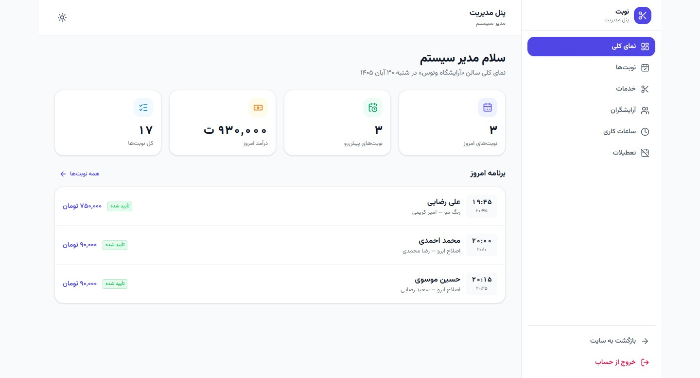

# نوبت

سامانه رزرو آنلاین نوبت آرایشگاه و سالن زیبایی، آماده برای استقرار در محیط عملیاتی.

معماری **Modular Monolith تمیز** با **ASP.NET Core 10** در سمت API و **Nuxt 4** در سمت رابط کاربری؛
کاملاً فارسی و راست‌چین، با تقویم شمسی، ساعت ۲۴ ساعته و حالت روشن و تاریک.




---

## ویژگی‌های برجسته

- **رزرو بدون تداخل.** زمان‌های آزاد از ساعات کاری، مدت خدمت، استراحت، نوبت‌های موجود و حداقل
  فاصله زمانی محاسبه می‌شوند. علاوه بر این، خودِ دیتابیس هم با قید انحصاری PostgreSQL روی
  `tstzrange` از تداخل جلوگیری می کند؛ یعنی حتی اگر دو مشتری همزمان یک زمان را انتخاب کنند،
  تنها یکی از آنها نوبت می گیرد.
- **مدیریت درست زمان.** همه زمانها به صورت UTC ذخیره می شوند و منطقه زمانی کسب و کار
  (`Asia/Tehran`) از طریق `IBusinessTimeProvider` تزریق می شود، نه اینکه در کد hard-code شود.
- **تقویم شمسی دقیق.** تبدیل تاریخ جلالی به صورت حسابی پیاده سازی و با تستهای گسترده تثبیت شده است؛
  دلیلش انحراف یک روزه برخی کتابخانههای محبوب در تاریخهای خاص است.
- **خطاهای ساختاریافته و فارسی.** خطاهای دامنه و خطاهای اعتبارسنجی FluentValidation به
  `ProblemDetails` مطابق RFC 7807 تبدیل می شوند، با کد ثابت `code` و نگاشت خطا به ازای هر فیلد.
- **تست در سه سطح.** ۱۲۵ تست بکاند، ۵۵ تست واحد فرانتاند و ۱۵ تست End-to-end با Playwright.
  جزئیات در [docs/testing.md](docs/testing.md).

## فناوریها

| لایه | فناوری |
| --- | --- |
| فرانتاند | Nuxt 4, Vue 3, TypeScript, Tailwind CSS 4, Nuxt UI, Pinia, Lucide icons |
| بکاند | ASP.NET Core 10 Web API, MediatR (CQRS-lite), FluentValidation |
| دیتابیس | EF Core 10, PostgreSQL 17, ASP.NET Core Identity |
| احراز هویت | توکن دسترسی JWT (۱۵ دقیقه) + توکن تازهسازی چرخشی (۷ روز) |
| تست | xUnit, Vitest, Playwright |
| استقرار | Docker, Docker Compose, GitHub Actions |

## شروع سریع

### Docker Compose (پیشنهادی)

```bash
git clone https://github.com/mohammadhashemlou/nobat.git
cd nobat
cp .env.example .env
docker compose up --build
```

| سرویس | آدرس |
| --- | --- |
| فرانتاند | http://localhost:3000 |
| API | http://localhost:5000 |
| Swagger UI | http://localhost:5000/swagger |
| سلامت سرویس | http://localhost:5000/health |
| PostgreSQL | localhost:5432 |

API هنگام شروع، مایگریشنها را اعمال و دیتابیس را پر می کند. حساب مدیر پیشفرض:

```
09120000000 / Admin@123456
```

تمام حسابها با شماره موبایل شناسایی می شوند و ایمیل در هیچ قسمتی از جریان کار استفاده نمی شود.

> قبل از در معرض قرار دادن برنامه، حتماً این رمز و `JWT_SECRET` را تغییر دهید.

### توسعه به صورت دستی

پیشنیازها: .NET 10 SDK، Node.js 22 و PostgreSQL 17.

```bash
# 1. دیتابیس
docker compose up -d postgres
#    یا هر نمونه PostgreSQL 17 دیگری؛ سپس API را به آن متصل کنید:
#    export ConnectionStrings__Default="Host=localhost;Port=5432;Database=nobat;Username=nobat;Password=nobat_dev_password"

# 2. API  (در اولین اجرا اسکیما و دادههای اولیه ساخته می شود)
cd backend
dotnet restore
dotnet run --project src/Nobat.Api          # http://localhost:5080, Swagger در /swagger

# 3. فرانتاند
cd frontend
npm install
npm run dev                                 # http://localhost:3000
```

آدرس API توسط فرانتاند از `NUXT_PUBLIC_API_BASE` خوانده می شود
(پیشفرض `http://localhost:5080`، نگاه کنید به `frontend/.env.example`).

## تستها

```bash
cd backend  && dotnet test        # ۱۲۵ تست (تستهای یکپارچه به PostgreSQL نیاز دارند)
cd frontend && npm run test       # ۵۵ تست Vitest
cd frontend && npm run test:e2e   # ۱۵ تست Playwright (هر دو سرور باید در حال اجرا باشند)
```

جزئیات کامل، از جمله نحوه کار دیتابیس موقت تست و دلیل دستنویس بودن تبدیل تقویم جلالی، در
**[docs/testing.md](docs/testing.md)** است.

## استقرار در محیط عملیاتی

```bash
cp .env.example .env      # POSTGRES_PASSWORD, JWT_SECRET, FRONTEND_ORIGIN, PUBLIC_API_BASE را تنظیم کنید
docker compose -f docker-compose.prod.yml up -d --build
```

هر دو ایمج multi-stage هستند و به عنوان کاربر non-root اجرا می شوند و بررسی سلامت دارند:

- `backend/Dockerfile` — خروجی Release را روی ASP.NET Core runtime قرار می دهد (`:8080`)؛
- `frontend/Dockerfile` — Nuxt را به `.output/` میسازد و با Node سرو می کند (`:3000`).

فایل `docker-compose.prod.yml` در صورت نبودن هر یک از مقادیر لازم، از شروع جلوگیری می کند و
راهاندازی فرانتاند را به سلامت بکاند گره زده است.

## ساختار پروژه

```
nobat/
├── backend/
│   ├── src/
│   │   ├── Nobat.Domain/          # موجودیتها، enumها، خطاهای دامنه — بدون وابستگی
│   │   ├── Nobat.Application/     # موارد استفاده، DTOها، اعتبارسنجیها، موتور محاسبه زمان
│   │   ├── Nobat.Infrastructure/  # EF Core، مایگریشنها، Identity، JWT، ارائهدهنده زمان
│   │   └── Nobat.Api/             # کنترلرها، middleware، تزریق وابستگی، Swagger
│   └── tests/
│       ├── Nobat.Domain.Tests/
│       ├── Nobat.Application.Tests/
│       └── Nobat.Api.Tests/       # تستهای یکپارچه با PostgreSQL واقعی
├── frontend/
│   ├── app/                       # صفحات، کامپوننتها، composableها، استورها، لایهها
│   ├── tests/unit/                # Vitest
│   └── tests/e2e/                 # Playwright
├── docs/
│   ├── architecture.md
│   ├── testing.md
│   └── screenshots/
├── docker-compose.yml             # توسعه (hot reload)
├── docker-compose.prod.yml        # ایمجهای عملیاتی
└── .github
```

قاعده وابستگی: `Domain ← Application ← Infrastructure ← Api`. منطق کسب و کار هرگز داخل کنترلرها
نمی نویسد و لایه Application از طریق `IApplicationDbContext` با دیتابیس صحبت می کند، بنابراین به
EF Core و ASP.NET وابستگی ندارد. جزئیات بیشتر در [docs/architecture.md](docs/architecture.md).

## قابلیتها

- **احراز هویت و سطوح دسترسی** — سه نقش Admin، Barber و Customer؛ توکن کوتاهمدت همراه با تازهسازی
  چرخشی.
- **صفحه عمومی سالن** — خدمات، قیمتها و آرایشگران همراه با فرآیند چهارمرحلهای رزرو.
- **پنل مدیریت** (`/panel`) — خدمات، آرایشگران، ساعات کاری، تعطیلات و نوبت‌ها.
- **موتور زمانبندی** — ساعات کاری، مدت خدمت، زمانهای استراحت، حداقل فاصله زمانی و نوبتهای ثبتشده،
  با گام ۱۵ دقیقهای.
- **جلوگیری از تداخل نوبت** — بررسی در سطح اپلیکیشن برای پاسخ دوستانه 409، به همراه قید انحصاری
  دیتابیس به عنوان مرجع نهایی.
- **چرخه عمر نوبت** — در انتظار، تأییدشده، تکمیلشده، لغوشده و عدم حضور، با تاریخچه کامل تغییر وضعیت.
- **ناحیه مشتری** — تاریخچه نوبتها و امکان لغو.
- **کاملاً فارسی و راست چین** — تقویم شمسی، ساعت ۲۴ ساعته، فونت Vazirmatn و ارقام فارسی.
- **حالت روشن و تاریک**، طراحی واکنشگرا موبایلمحور و وضعیتهای بارگذاری، خالی و خطا در همه بخشها.

## API

مستندات تعاملی در محیط توسعه در مسیر `/swagger` ارائه می شود. تمام نشانیها تحت `/api/v1` نسخهبندی
شدهاند:

| حوزه | نشانیها |
| --- | --- |
| احراز هویت | `POST /auth/register`, `POST /auth/login`, `POST /auth/refresh`, `GET /auth/me` |
| سالنها | `GET /salons/{slug}`, `GET /salons/{id}`, `PUT /salons/{id}` |
| خدمات | `GET/POST /services`, `PUT/DELETE /services/{id}` |
| آرایشگران | `GET/POST /barbers`, `PUT /barbers/{id}`, `GET/PUT /barbers/{id}/working-hours` |
| تعطیلات | `GET/POST /holidays`, `DELETE /holidays/{id}` |
| نوبتها | `GET /appointments/availability`, `GET/POST /appointments`, `PATCH /appointments/{id}/status`, `POST /appointments/{id}/cancel` |

## مجوز

MIT
